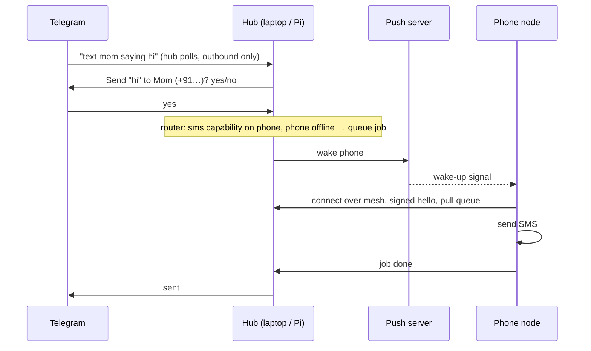
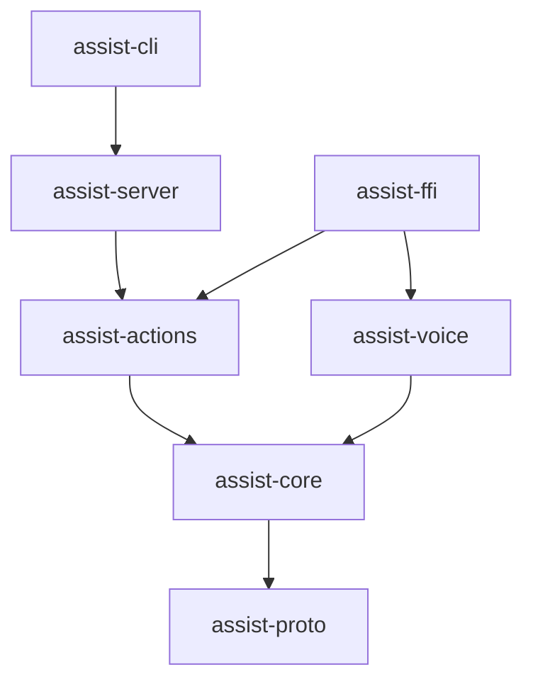

# PLAN — Assist, a personal automation & voice assistant

> Project name `assist` (crates `assist-*`, binary `assist`). The assistant's name, wake word and how it
> addresses you are configuration (`[persona]`, defaults "Bee" / "Prime"); no persona name is hard-coded.
> Items marked **(default)** are recommended defaults still waiting for owner confirmation (§12).

Offline-first, automation-first, AI-optional personal assistant.
One Rust core runs on every device; each platform adds a thin native layer.
Primary: desktop (Linux + Windows). Secondary: Android. Later: Raspberry Pi, ESP32, Arduino.
Hardware target is **low-spec** (weak laptop, weak phone). Every decision optimises for low CPU,
low RAM, fast response and security.

---

## 1. Principles (non-negotiable)

1. **Text in, text out.** The core never touches mic, speaker, screen or network. Its only I/O is
   its own data directory. Voice, chat, CLI, Telegram, API are adapters.
2. **Automation first, AI optional.** Rules → semantic match → optional LLM. Everything works with
   no LLM and no internet.
3. **Dialog, not one-shot.** Missing details are asked for, ambiguity is asked about, risky actions
   are read back and need "yes", follow-ups and corrections work, "cancel" works in every state.
4. **Risk is data.** A policy table (capability × trust) plus per-command `risky` lives in config.
5. **Narrow recognition beats smart recognition.** Command mode uses a grammar built from the
   configured phrases, narrowed by context. Dictation only for free-text slots.
6. **Data is never a command.** Output of OCR, scraping, LLM, messages can only *propose* actions;
   it is never fed back into the matcher.
7. **Every control is a protocol call.** CLI, dashboard, Telegram and phone are equal clients.
8. **Secrets by name, write-only.** No API returns a secret value.
9. **Local by default, network by choice.** Localhost / mesh only, auth on every connection,
   Host + Origin check, audit log. Every online feature is opt-in per device.
10. **Logic in Rust, platform glue in Kotlin/OS code.**
11. **Extend without breaking.** Stable `Action` trait, versioned additive protocol.
12. **Interop over re-implementation.** Speak MCP, MQTT, Wyoming, webhooks instead of rebuilding
    what Home Assistant, n8n or KDE Connect already do.
13. **Small first.** Each crate, dependency and feature arrives in the phase that needs it.

---

## 2. Requirements (condensed)

- Do tasks: open apps, run shell/scripts, search, scrape, build/test projects, run tools.
- Transform & route: filter/transform input and **pipe** it to another action, app, API, file, chat.
- Phone: SMS, calls, contacts, media, lock, recording, OCR.
- Triggers: voice, CLI, chat UI, Telegram, web, MCP, timers, file watch, device context
  (battery, Wi-Fi, focused app). Every action reachable from every interactive trigger.
- Messaging: Telegram and WhatsApp.
- Realtime OCR, STT, TTS. Optional AI / MCP.
- **Control panel:** see every running, queued, paused and finished job; stop, pause, resume,
  re-run; manage API keys and settings.
- **Jarvis feel:** persona, long-term memory, proactive alerts, free conversation, barge-in,
  room microphones (§3.17).
- Secure encrypted device-to-device communication.
- Open source wherever possible.

---

## 3. Architecture

### 3.1 Shape

```
 Triggers (adapters)          assist daemon: one per device ("node")                    Actions
 ───────────────────          ──────────────────────────────────────────────────        ─────────────────
 CLI ───────────┐             ┌ Gateway: Host+Origin check, token/cookie → Principal ┐   built-in (Cargo features)
 Web chat/Dash ─┤             │                                                      │    shell, scripts, apps,
 Voice ─────────┤  Utterance  │ Normalize → Match → Dialog → Policy → Scheduler ─────┼──► search, scrape, files,
 Telegram ──────┼───────────► │  rules→semantic→LLM  (per conv)  (table)  lanes+locks│    ocr, screen, record,
 Timer/Watch ───┤             │                                                      │    messaging, net-tools
 MCP / webhook ─┘             │ Facts  Secrets(trait)  Store(SQLite)  Audit  Router  │   external: MCP servers
 Sinks ◄── Reply / JobUpdate ─└──────────────────────────────────────────────────────┘
 chat, speak, Telegram, file, webhook, notify, dashboard
```

- **Daemon + thin clients.** One daemon per device ("node").
- **Built-in actions** run in-process behind Cargo features.
- **External plugins are MCP servers over stdio.** Each MCP tool becomes an `Action`. A crashing
  plugin never takes the daemon down.

### 3.2 Request flow

1. Adapter sends text; the gateway attaches a **Principal** →
   `Utterance { text, principal, conv }`.
2. **Normalize** (case, punctuation, number words) → **Match**:
   1. rules (compiled phrases) →
   2. semantic match (small embedding model vs. all phrases, Phase 2) →
   3. optional LLM constrained to `{command, slots}` from the command list (Phase 7).
   Result: `Intent { command, slots, score }`, `Suggestions`, or shell (`$` prefix / accepted
   "run as shell?").
3. **Dialog** per conversation (§3.5).
4. **Policy** (§3.6) → allow / confirm / deny.
5. **Scheduler** creates a **Job**, replies `accepted #42` (< 50 ms).
6. Action runs with `JobCtx`; output streams to subscribers, next pipe stage, sinks.
7. Every transition is appended to the audit log.

### 3.3 Protocol

One protocol everywhere: **WebSocket**, **JSON text frames (default)**; audio/image chunks as
binary frames whose header references the message `id`. MessagePack may be negotiated later via
WS subprotocol — if so it must use named (map) encoding (`rmp_serde::to_vec_named`), otherwise
adding fields breaks old clients.

```rust
struct Envelope {
    v: u16,              // 1
    id: Uuid,            // this message
    re: Option<Uuid>,    // message this answers
    conv: Option<Uuid>,  // conversation; dialog state key
    kind: Kind,          // hello | utterance | reply | job_update | subscribe | event
                         // | rpc | rpc_result | sync | ping | pong
    from: NodeId,
    to: Dest,            // node id | "hub"
    ts: u64,             // unix ms; HLC only inside sync events
    body: serde_json::Value,
}
```

- Unknown fields and kinds are ignored (and logged). Changes are additive only.
- Admin operations use `rpc { method, params }`: `jobs.list`, `jobs.control`, `secrets.set`,
  `config.set`, `facts.get`, … — not new kinds.
- `subscribe { topics }` → snapshot, then deltas (dashboard, CLI `jobs --watch`).
- No gRPC/QUIC, no local IPC transport in v1: the CLI uses the localhost WebSocket.

### 3.4 Principals and trust

```rust
struct Principal { source: Source, user: String, node: NodeId, trust: Trust }
enum Trust { Local, OwnerRemote, Voice, Untrusted }
```

| Trust | Who |
|---|---|
| `Local` | CLI with token, dashboard cookie, on this machine |
| `OwnerRemote` | paired device over mesh, allowed Telegram user IDs |
| `Voice` | mic on any device (anyone in the room, a TV included); raised to `VoiceOwner`-level confirm rights only with speaker verification (Phase 2) |
| `Untrusted` | LLM proposals, MCP clients, OCR/scraped/message content, webhooks |

Timers, file watch and context triggers are **unattended**: they run only commands marked
`unattended = true` and can never confirm. Autopilot goals (§3.18) are unattended too and use
their own `autopilot` policy column.

### 3.5 Dialog

States: `Idle → Asking(slot) | Disambiguating(candidates) → Confirming(frozen plan) → Submitted`.

- `cancel` valid in every state; pending questions expire.
- **Disambiguation:** fuzzy slot matches with several candidates → "Sam Lee or Sam Roy?".
- **Follow-ups:** last command + slots kept per conversation ("open firefox" … "close it").
- **Corrections:** "no, I meant dad" re-fills the last slot and re-confirms.
- **Multi-intent:** split on "and"/"then" only when every part matches a command.
- **Confirmation binding:** a "yes" counts only from the same principal + conversation (or a
  `Local` principal on the dashboard), within the timeout. The readback shows the fully resolved
  action (exact shell string, number, file list). Arguments are frozen once confirmed.

### 3.6 Policy

Default table (overridable in config). Decisions: `allow | confirm | deny`.

| Capability | local | owner_remote | voice | untrusted | autopilot |
|---|---|---|---|---|---|
| `read` (search, fs.read, ocr, screen) | allow | allow | allow | confirm | allow |
| `apps`, `media` | allow | allow | allow | confirm | allow |
| `shell` | allow if typed `$`, else confirm | confirm (Telegram off by default) | deny | confirm | deny (named scripts granted by the goal only) |
| `fs.write`, `delete`, `rename.bulk` | confirm | confirm | confirm on screen | confirm | allow inside the goal's `paths`, else confirm; `delete` always confirm |
| `send` (sms, call, telegram, post) | confirm | confirm | confirm by voice | confirm | only to the owner (`notify`, `telegram me`), else confirm |
| `net.scan` | confirm + scope allowlist | deny | deny | deny | deny |
| `secrets.write`, `config.write`, `admin` | allow (dashboard) | deny | deny | deny | deny |

"confirm" for autopilot means the step waits in the dashboard **Waiting** tab (or Telegram) until
you answer; the goal pauses meanwhile.

- Per-command `risky = true` forces confirm.
- **Taint rule:** output of an action with `untrusted_output` stays tainted through all later
  pipe stages; tainted data reaching a `send` sink always needs confirmation.
- Policy may read facts (§3.10), e.g. "deny `send` when `screen.locked` and source is voice".
- Capabilities are policy labels, not isolation, until sandboxing (later: landlock).

### 3.7 Matcher and phrases

Phrase files are **TOML** (no YAML dependency).

```toml
# config/phrases/en/messaging.toml
[send_sms]
slots   = { contact = "list:contacts", text = "text" }
phrases = ["(send (a)? message|text) (to)? .contact. (saying .text.)?"]
```

Syntax: `a|b` alternatives, `( )` grouping, `?` optional, `.name.` slot.

Slot types:
- `list:<table>` — closed values from config (apps, contacts, scripts, pipes); fuzzy via `strsim`.
- `number`, `duration`, `time` — built-in parsers.
- `text` — free text (dictation in voice mode).

Implementation: a small hand-written parser (no library) → compiled to `regex`; a `RegexSet` finds candidates,
captures fill slots. Tie-break: most literal words wins. Default phrases are embedded in the
binary; user files override per command. The matcher sits behind a `Matcher` trait so the
semantic and LLM stages plug in without changing callers.

- **Context-aware grammars:** each command may declare `when = "app.focused == 'code'"`; only
  active commands go into the voice grammar (smaller grammar → fewer errors).
- **Filler words:** when the input as said matches nothing, the rule stage tries again without
  leading and trailing filler words ("okay so can you ... please"); the English lists live in
  the matcher.
- **Semantic stage (deferred from Phase 2):** small sentence-embedding model (bge-small / MiniLM
  class, ONNX, ~30 MB, measure) compares input with all phrases; above threshold → Intent, else
  suggestions. Built when recorded misses show paraphrases the rules and filler words cannot
  catch.
- **Learn from misses:** unmatched input is logged; the dashboard suggests "add 'fire up chrome'
  as a phrase for `open_app`?".
- Evaluate compatibility with Home Assistant `hassil` sentence templates (shared phrase data and
  test format for many languages) before the syntax grows.

### 3.8 Jobs and scheduler

```rust
struct Job { id: JobId /* node:seq, e.g. laptop:42 */, command, slots, principal, conv, node,
             lane: Lane, state: JobState, group: Option<JobId> /* pipe */, created, started,
             finished, exit: Option<i32>, output: OutputRef }
enum JobState { Queued, Running, Paused, Done, Failed, Cancelled, TimedOut, Interrupted }
```

- **Lanes:** `interactive` (default 2 concurrent), `background` (default 3). Background processes
  run at low OS priority (`nice` / `BELOW_NORMAL_PRIORITY_CLASS`).
- **Exclusive resources:** `mic`, `camera`, `screen_record`, `speaker` — a second job queues.
- **Controls:** stop, pause, resume, re-run, raise priority, **STOP ALL** (kill switch: cancels
  everything and disables remote sources until re-enabled; also a hotkey).
- **Stop** kills the whole process tree (Job Objects on Windows, process groups on Linux).
- **Pause:** queued → held; external process → SIGSTOP/SIGCONT (Linux), `NtSuspendProcess`
  (Windows, best effort); built-in → cooperative checkpoint. Actions declare `pausable`.
- **Durability:** after a daemon restart, `Running` jobs become `Interrupted` with a re-run
  button. Schedules missed while asleep follow `missed = "run" | "skip"`.
- Per-job timeout, output cap; last 64 KB in SQLite, full log in `jobs/<id>.log` with retention.
- Pending dialogs (waiting for an answer / "yes") are listed separately, not as a job state.

### 3.9 Actions (plugin contract)

```rust
pub trait Action: Send + Sync {
    fn manifest(&self) -> &Manifest;
    fn run(&self, ctx: JobCtx, input: Input, out: Output) -> BoxFuture<'static, Result<(), ActionError>>;
}
pub struct Manifest {
    name: &'static str, version: &'static str,
    input: DataKind, output: DataKind,   // Text | Lines | Json | File | Image | Audio | Empty
    capabilities: &'static [Capability],
    pausable: bool, untrusted_output: bool, undo: bool,
    exclusive: &'static [Resource], platforms: &'static [Os],
}
pub struct JobCtx { job: JobId, principal: Principal, cancel: CancellationToken,
                    pause: PauseGate, secrets: SecretGrant, facts: FactsRead,
                    limits: Limits, cwd: PathBuf }
// Input/Output = bounded tokio mpsc of Chunk → backpressure.
```

- Unsupported on this device → "not available here" or route to a node that has it (§3.13).
- `undo = true` actions write an undo record (bulk rename first).

### 3.10 Facts (device state)

A small key/value store of current state, updated by adapters, read by triggers, policy, context
grammars and pipe conditions: `node.battery`, `node.charging`, `net.ssid`, `screen.locked`,
`app.focused`, `location.zone` (phone), `user.away`. Facts are not synced by default; a node can
publish selected facts to the hub. (Built in Phase 3 together with its first consumers.)

### 3.11 Pipes

`ocr screen | filter error | telegram me`

- Each stage is a job; the pipe is one job group. Data kinds are type-checked at parse time.
- Built-in transforms: `filter`, `grep`, `map`, `count`, `sort`, `uniq`, `head`, `json`,
  `save <path>` (`fs.write`), `post <url>` (`send`).
- Control: `on_error = "<pipe>"`, `retry = N`, `if <fact condition>`. No visual editor.
- Saved pipes are named commands in config.

### 3.12 Triggers

Adapters that emit Utterances, so the core never changes: CLI, web, voice, Telegram, MCP client,
webhook (`Untrusted`), timer (`[[schedules]]`), file watch (`notify`), fact change
(`on = "node.battery < 20"`). Unattended rules from §3.4 apply.

### 3.13 Nodes, remote, sync (Phase 5)



- **Topology:** hub-and-spoke inside a WireGuard mesh (NetBird or Headscale). The hub never
  accepts connections from the internet; Telegram and push are outbound.
- **Pairing:** QR code exchanges ed25519 keys; `hello` is signed and announces capabilities.
  No own PKI (`rcgen` dropped). Evaluate `iroh` as an all-in-one alternative.
- **Router** sends a job to a node with the needed capability. **Store-and-forward** queue for
  offline nodes; queued jobs expire (default 1 h → `TimedOut` + reply).
- **Single owner:** the node running a job owns its state.
- **Phone:** no long-lived connection (Android 15 caps `dataSync` foreground services); UnifiedPush
  wake → short connection.
- **Sync:** each node has its own SQLite + event log; config = last-writer-wins per key with HLC.
  Secrets and facts are not synced by default. Files: Syncthing.
- Later cheap features on the same plumbing: clipboard sync, notification mirroring, send file,
  ring my phone.
- **Interop:** publish nodes via MQTT discovery so Home Assistant can see/trigger them; accept
  webhooks; MCP server for LLM clients.

### 3.14 Secrets

- `SecretStore` trait in the core. Desktop: `keyring` (Windows Credential Manager, Secret
  Service), fallback `age`-encrypted file. Android: Keystore via UniFFI callback.
- Config refers to secrets by name only. API: add, replace, delete, list metadata — never read.
- Per-secret allowlist of actions/plugins; MCP plugins get secrets as env vars only if granted.
  The LLM never sees secrets.
- Known secret values are scrubbed from job output and logs. Changes are local-only and audited
  without the value.

### 3.15 Dashboard (control panel)

Same embedded web UI as the chat, as tabs:

- **Jobs:** live list (running, queued, paused, finished), filters, live log, controls (§3.8),
  header with daemon CPU/RAM and lane usage, per-job CPU/RAM (Phase 3).
- **Waiting:** pending questions and confirmations from every source; approve/deny here.
- **Secrets:** name, last 4 chars, used by, set/last used; add, replace, delete.
- **Settings:** sources, `risky`, lanes, timeouts; written with `toml_edit` (comments kept);
  live reload with validation errors.
- **Commands:** all commands and phrases, a test box (match, slots, policy decision — "explain"
  mode, also `assist explain "<text>"`), and suggested phrases from misses.
- **Audit:** filterable audit log.
- **Memory:** every remembered record with its source; edit, delete, export, forget all.
- **Proactive:** active rules, last fired, mute / quiet hours.
- **Autopilot:** goals, status, budget used, step history; pause / stop / edit per goal.
- **Clients:** connected CLI/browser/phone sessions with revoke.
- **Nodes** (Phase 5): devices, capabilities, last seen, queued jobs.

Rules: output rendered with `textContent` only; strict CSP (`default-src 'self'`, no inline
scripts); admin tabs local-only; remote dashboard (phone over mesh) is read-only + stop.
The phone uses this dashboard over the mesh instead of a separate Compose screen.

### 3.16 Storage (per-node data dir via `directories`)

```
config.toml  phrases/  token
assist.db             # SQLite WAL: jobs, output tails, schedules, facts, (later) event log, node queue
audit/YYYY-MM.jsonl   # hash-chained, secrets redacted
jobs/<id>.log         # full job output, retention 7 days / 500 MB
logs/                 # rolling tracing logs
```

Memory (§3.17) lives in `assist.db` in its own tables.

### 3.17 Jarvis layer

Six features that make the assistant feel conversational and aware. All are adapters, actions or
reply post-processing — the core flow (§3.2) does not change, and policy still decides every
action.

| Feature | What it does | Works without LLM? | Phase |
|---|---|---|---|
| **Persona** | Reply templates with a configurable style ("Done, Prime."); per-language strings in `phrases/<lang>/replies.toml`. With an LLM enabled, replies may be rephrased in the persona's voice (facts and numbers are never rewritten) | Yes (templates) | 2 (templates), 7 (LLM rephrase) |
| **Long-term memory** | Remembers preferences, people, routines ("usually leaves at 8"). Stored locally in SQLite as typed records `{subject, fact, source, created, last_used}`; added only by explicit "remember …" or by confirming a suggestion. Used to fill slots and personalise replies | Yes (explicit facts) | 3 (explicit), 7 (LLM recall/suggestions) |
| **Proactive engine** | Rules over events and facts that speak up unasked: build failed, meeting in 10 min, battery low, unknown device on Wi-Fi. Respects quiet hours, per-rule rate limits, presence (`user.away`) and output sink (speak / notify / Telegram) | Yes | 3 |
| **Conversation mode** | Input that matches no command (and isn't `$`) goes to the LLM as chat, with recent conversation + relevant memory as context. The LLM may *propose* actions as `{command, slots}`; they go through dialog + policy as `Untrusted` | No | 7 |
| **Barge-in** | Interrupt while it speaks: wake word or "stop" cuts TTS immediately; full barge-in ("no, the other one") needs acoustic echo cancellation | Yes | 2 (stop on wake word), 7 (full AEC) |
| **Room microphones** | ESP32-S3 satellites per room stream audio to the hub over Wyoming; the reply plays in the room that asked | Yes | 9 |

Rules:
- **Memory is transparent:** dashboard **Memory** tab lists every record with source; edit,
  delete, export, "forget everything". `assist memory list|forget`.
- **Never stored as memory:** secrets, passwords, card numbers, one-time codes, message bodies,
  OCR/scraped text (unless you explicitly say "remember this").
- **Memory never leaves the device** except the minimal relevant records sent with an opt-in cloud
  LLM request; each such request is audited.
- **Proactive output is rate-limited and quiet-hours aware;** every rule can be muted from the
  dashboard or by saying "stop telling me about X".
- **The LLM never runs actions directly** and never sees secrets.

### 3.18 Autopilot mode

Standing **goals** instead of one-off commands ("keep Downloads sorted", "every morning check the
build, summarise failures and send them to me"). The project name stays `assist`: by default it
helps; autopilot is opt-in autonomy with limits you set. It is a trigger adapter plus a policy
column — the core flow (§3.2) does not change.

- **Goal** = `{name, objective, trigger, allowed commands, paths, budget, expires}` in config or
  created by voice/chat ("take over the Downloads folder") and confirmed once.
- **Planner:** rules/saved pipes first; with the LLM enabled, it plans steps constrained to the
  goal's allowed commands (`{command, slots}` only). Each step is submitted as a normal job with
  principal source `autopilot`, so policy, taint, audit and STOP ALL apply unchanged.
- **Budgets:** max jobs per run and per day, max runtime, max cloud-LLM spend; exceeding any
  budget pauses the goal and notifies you.
- **Guardrails:** goals can only use commands listed in `allow`; `delete`, `send` to others,
  `net.scan`, secrets and config changes are never autonomous; no goal can create or widen
  another goal; goals expire unless renewed.
- **Visibility:** dashboard **Autopilot** tab, `assist autopilot list|on|off|pause <goal>`,
  "Bee, stop autopilot" (persona name from config). Every step is audited with its goal.

Phases: rule-based goals (saved pipes + triggers + budgets) in Phase 3; LLM planning in Phase 7.

---

## 4. Tech stack (final)

⊕ = not in the original plan; approved with this revision (defaults, see §12).

### Core

| Concern | Choice |
|---|---|
| Async runtime | `tokio`; ⊕ `tokio-util` (`CancellationToken`) |
| Serialization | `serde`, `serde_json` (MessagePack deferred) |
| Config | `toml`, ⊕ `toml_edit`, `directories` |
| Phrases / matching | hand-written phrase parser → ⊕ `regex`; `strsim` |
| Semantic match (Phase 2) | sentence-embedding ONNX model via the voice runtime (sherpa-onnx / `ort`) |
| Storage | `rusqlite` (bundled, WAL) from Phase 1b |
| IDs, audit chain | ⊕ `uuid`, ⊕ `sha2` |
| Logging | `tracing`, `tracing-subscriber`, ⊕ `tracing-appender` |
| Errors | `thiserror` (libraries), `anyhow` (binaries) |
| Allocator (optional) | `mimalloc`, only if measured |

### Server / CLI

| Concern | Choice |
|---|---|
| HTTP + WebSocket | `axum` (ws), `tokio-tungstenite` (client) |
| Embedded UI | `include_str!` of `web/` (no build step, no extra crate); plain HTML/CSS/JS |
| CLI | `clap` |
| MCP | `rmcp`: server, and client for plugins (Phase 7) |

### OS / desktop

| Concern | Choice |
|---|---|
| Process trees | ⊕ `process-wrap` |
| Metrics (Phase 3) | ⊕ `sysinfo` (sampled only while the dashboard subscribes) |
| Secrets | `keyring`, fallback `age` |
| Automation | `open`, `enigo`, `arboard`, `notify-rust`, `xcap`, `global-hotkey` |
| File watch | `notify` |
| Windows APIs | ⊕ `windows` / `windows-sys` (OCR, priority, suspend) |

### Voice (Phase 2)

| Concern | Choice |
|---|---|
| Audio | `cpal`; resampling by sherpa-onnx's `LinearResampler` (`rubato` not needed) |
| VAD, wake word, STT, speaker verification | official `sherpa-onnx` crate (**decided** by the Phase 2 spike, `spikes/voice`): Silero VAD, open-vocabulary keyword spotting, streaming Zipformer; Moonshine/Parakeet for dictation and files. Vosk dropped. Capture keeps a 1 s pre-roll; streaming models get 2 s of zero padding after the endpoint to flush the last word |
| TTS | OS TTS **(default)** (SAPI/WinRT, speech-dispatcher, Android TextToSpeech); Piper/Kokoro as an **external process** (Piper is now GPL-3.0 via espeak-ng) |
| Interop | Wyoming protocol adapter (reuse external wake/STT/TTS servers, remote STT); deferred from Phase 2 until a Wyoming server or the Phase 9 room microphones use it |
| Recording | `ffmpeg` (external) |

### Vision / web

| Concern | Choice |
|---|---|
| OCR | trait: Windows built-in OCR on Windows, `ocrs` elsewhere, Tesseract external fallback |
| Web | `reqwest` (rustls), `scraper`; `chromiumoxide` later |

### Messaging

| Concern | Choice |
|---|---|
| Telegram bot | `teloxide` or thin `reqwest` client (decide Phase 5) |
| Telegram as you | TDLib (Phase 6) |
| WhatsApp | `wa.me` intent + accessibility tap (Phase 6) |
| Phone wake-up | UnifiedPush / ntfy |
| Optional E2E | `matrix-rust-sdk` (later) |

### Security / network

| Concern | Choice |
|---|---|
| TLS | `rustls` |
| Device identity | `ed25519-dalek`, QR pairing |
| Mesh | NetBird or Headscale; evaluate `iroh` |
| SSH / sandbox (later) | `russh`, `landlock` / bubblewrap |
| Supply chain | `cargo-deny` (licenses, advisories, bans) |
| MCP plugins | version + hash pinned in config, never auto-updated |

### LLM (Phase 7, optional)

Local llama.cpp / Ollama (3–4B class) or a cloud API, opt-in. Output constrained by grammar /
JSON schema to `{command, slots}` from the command list. The same backend serves conversation
mode, persona rephrasing and memory suggestions (§3.17). Good local conversation needs stronger
hardware (used mini PC / GPU) than the low-spec target; on weak hardware use cloud or stay
command-only.

Echo cancellation for full barge-in (Phase 7): WebRTC audio processing (evaluate a binding crate
and its license), or OS-level AEC where available (Android `AcousticEchoCanceler`).

### Android (Phase 4)

Kotlin, Jetpack Compose, Coroutines/Flow, DataStore, no Hilt. Core via **UniFFI**, built with
**cargo-ndk** (`arm64-v8a`). Same sherpa-onnx voice engine through the core. Android Keystore for
secrets. Details §7.2.

### Hardware (Phase 9)

`cross` (Pi), `rppal` (GPIO), `rumqttd` + `rumqttc` (MQTT, TLS), `esp-idf-hal` or `embassy`
(ESP32, including a **voice-satellite** role over Wyoming), `serialport` (Arduino).

### Tooling

`just` (`windows-shell` = pwsh), `cargo-nextest`, `insta`, `criterion`, `cargo-deny`,
`cargo-dist`, GitHub Actions **(default)** matrix Ubuntu + Windows, fuzzing of the envelope
decoder in Linux CI. Windows dev: rustup MSVC + VS Build Tools, WSL2 for Linux.

### Dropped

`serde_yaml`, `cargo-audit` (covered by `cargo-deny`), `cedar-policy`, `jsonrpsee` + own Python
SDK (MCP instead), `rcgen`, `interprocess` (deferred), `rmp-serde` (deferred). `wasmtime` stays
"maybe".

---

## 5. Repo layout

```
Cargo.toml  justfile  deny.toml  rust-toolchain.toml  .cargo/config.toml
CLAUDE.md  PLAN.md  LICENSE-MIT  LICENSE-APACHE
.github/workflows/ci.yml
config/
  config.example.toml
  phrases/en/*.toml       # embedded defaults; user phrases/ overrides
  cases.toml              # [[case]] text / command / slots
crates/
  assist-proto/    Envelope, Kind, Principal, Chunk, DataKind (serde only)       Phase 1b
  assist-core/     config, normalize, matcher, dialog, policy, scheduler, jobs,
                   pipes, facts, SecretStore trait, store, audit, router         Phase 0
  assist-actions/  one module + feature per action; *_windows/_linux/_android.rs;
                   MCP plugin host                                               Phase 1a
  assist-voice/    audio, VAD, wake, STT, TTS, semantic model (feature `voice`)  Phase 2
  assist-server/   axum: WebSocket, rpc, auth, dashboard, MCP server             Phase 1b
  assist-cli/      `assist`: serve | run | shell | jobs | stop | pause | explain | ui |
                   listen | secret | install-autostart; desktop SecretStore      Phase 1a
  assist-ffi/      UniFFI bindings                                               Phase 4
web/             chat + dashboard (index.html, app.js, style.css)                 Phase 1b
android/         Kotlin app                                                       Phase 4
plugins/         example MCP plugin configs                                       Phase 7
firmware/        esp32, arduino                                                   Phase 9
```

Crates are created only when their phase starts. Never name a crate `core` or `std`.



### Build targets (monorepo)

One repo, one Cargo workspace, one version. Every build compiles the same `assist-core` +
`assist-proto`; Cargo features decide what else goes in.

| Build | Contents | Command (just recipe) | From phase |
|---|---|---|---|
| **Core** | `assist-core` + `assist-proto`, no OS deps | `cargo test -p assist-core` (`just test`) | 0 |
| **Desktop full** | `assist` binary: server, UI, all desktop actions, voice | `cargo build -p assist-cli --release` (`just desktop`) | 1a |
| **Headless** | Hub / home server: server + non-screen actions, no voice/UI automation | `cargo build -p assist-cli --release --no-default-features --features headless` (`just headless`) | 1b |
| **Pi** | Headless + GPIO, `aarch64` | `cross build -p assist-cli --release --target aarch64-unknown-linux-gnu --no-default-features --features headless,gpio` (`just pi`) | 9 (try earlier as hub) |
| **Android** | `assist-ffi` cdylib inside the Kotlin app | `cargo ndk -t arm64-v8a build -p assist-ffi --profile android` + Gradle in `android/` (`just android`) | 4 |
| **Firmware** | ESP32 / Arduino | own toolchain in `firmware/`, **outside** the Cargo workspace (`just firmware`) | 9 |

Rules:
- **Feature sets** live in `assist-cli/Cargo.toml`: `default = ["desktop"]`,
  `desktop = ["server", "voice", "ui-actions", …]`, `headless = ["server", "shell", "scripts", …]`.
  Each action keeps its own feature (CLAUDE.md); bundles only group them.
- **One version** for all crates via `[workspace.package] version`; the Android `versionName`
  follows it. One tag (`vX.Y.Z`) releases everything.
- **Releases:** `cargo-dist` builds desktop (Windows, Linux) and headless (Linux x86_64,
  aarch64) binaries; Gradle builds a signed APK; all attached to the same release.
- **CI path filters:** Android job runs only on changes to `android/`, `assist-ffi`, core or
  proto; firmware only on `firmware/`; everything else runs core + desktop on Ubuntu and Windows.
- Split a part into its own repo only if it gets its own contributors or release cadence
  (firmware is the likely first, and is already outside the workspace).

---

## 6. Config

### Example

```toml
config_version = 1

[node]
id = "laptop"
role = "hub"                     # hub | node

[server]
bind = "127.0.0.1:7720"          # never 0.0.0.0; mesh interface only when remote is enabled

[lanes]
interactive = 2
background = 3

[jobs]
timeout = "10m"
output_tail_kb = 64
retention_days = 7
log_cap_mb = 500

[policy]                         # overrides of the default table (§3.6)
shell = { owner_remote = "deny" }

[net]
scan_scope = ["192.168.1.0/24"]

[sources.telegram]
enabled = false
allowed_user_ids = []

[commands.send_sms]
ask.text = "What's the message?"
risky = true

[apps]
firefox = { windows = "firefox.exe", linux = "firefox", android = "org.mozilla.firefox" }

[scripts]
backup = { windows = "C:/scripts/backup.ps1", linux = "~/scripts/backup.sh" }
build  = { run = "cargo build", lane = "background" }

[pipes]
morning = { run = "search weather today | head 3 | speak", unattended = true }

[[schedules]]                    # Phase 3
at = "07:30 mon-fri"
run = "morning"
missed = "skip"

[contacts]
mom = "+910000000000"

[secrets]                        # names + grants only; values live in the OS keystore
openai = { used_by = ["ai"] }

[plugins.github]                 # Phase 7: an MCP server as a plugin
command = ["github-mcp-server", "stdio"]
version = "x.y.z"
sha256 = "…"
capabilities = ["net", "send"]
secrets = { GITHUB_TOKEN = "github" }

[voice]
enabled = false

[persona]
name = "Bee"                     # assistant name; wake word = "hey <name>" (or set wake_word)
wake_word = ""                   # optional override, e.g. "bumblebee" if "hey bee" false-triggers
style = "formal"                 # formal | casual | terse
address = "Prime"                # how the assistant addresses you; "" for none

[proactive]
quiet_hours = "23:00-07:00"
max_per_hour = 4
sink = "notify"                  # notify | speak | telegram

[[proactive.rules]]              # Phase 3
on = "job.failed and job.lane == 'background'"
say = "Your {command} failed."

[memory]
enabled = true
cloud_share = false              # send relevant records with cloud LLM requests

[ai]
enabled = false                  # LLM fallback + conversation mode
mode = "local"                   # local | cloud

[autopilot]
enabled = false

[[autopilot.goals]]              # Phase 3 (rules), Phase 7 (LLM planning)
name = "tidy-downloads"
objective = "Sort Downloads into folders by file type"
trigger = { every = "1h" }
allow = ["move_file", "make_folder", "notify"]
paths = ["~/Downloads"]
budget = { jobs_per_day = 50, max_runtime = "5m", llm_spend_per_day = 0.0 }
expires = "30d"
```

### Test cases

```toml
# config/cases.toml
[[case]]
text = "text mom"
command = "send_sms"
slots = { contact = "mom" }
```

---

## 7. Platforms

### 7.1 Desktop (Linux X11 + Windows)

- `assist serve`: loads config + models once; starts WebSocket server, chat UI, dashboard, voice,
  MCP.
- `assist run "open firefox"`: one utterance, stream reply, exit. `assist shell`: REPL.
- `assist jobs | stop | pause | explain | secret | ui | listen`.
- Chat = shell: `$` input runs in bash / `pwsh -NoProfile -NonInteractive`; cwd persists per
  conversation; output streams live. Unmatched input → "run as shell command?".
- v1 runs non-interactive commands only; PTY + xterm.js later.
- OS-specific code behind `#[cfg(target_os = ...)]` in separate modules. Linux v1 = X11.

### 7.2 Android (own app)

| Need | Implementation |
|---|---|
| UI | Chat screen (Listen + text + history), settings; dashboard = hub web UI over mesh |
| Assistant trigger | `VoiceInteractionService` |
| Wake word | Foreground service type `microphone`, toggle (battery) |
| After reboot | Notification / tile, one tap to start mic service |
| Quick access | Home-screen widget, Quick Settings tile |
| Open apps | `PackageManager` + launch intents |
| Calls / SMS / contacts | `ACTION_CALL`, `SmsManager`, `ContactsContract` (fuzzy match in core) |
| Media | `AudioManager.dispatchMediaKeyEvent`, `MediaStore` |
| Lock / screenshot | AccessibilityService `GLOBAL_ACTION_LOCK_SCREEN`, `takeScreenshot` |
| Record | `MediaRecorder` / `MediaProjection` (consent every session) |
| Files / bulk rename | All-files access; dry run + confirm + undo |
| Notifications | `NotificationListenerService` |
| Facts | battery, charging, Wi-Fi SSID, location zone → fact store |
| Hub connection | UnifiedPush wake + short connection (no long-lived FGS) |
| Secrets | Android Keystore |
| Telegram as you / WhatsApp | TDLib / `wa.me` + accessibility tap |
| TTS | Android `TextToSpeech` |

Android 13+ sideloaded apps need "Allow restricted settings" before enabling Accessibility. No app
can bypass the PIN.

### 7.3 Raspberry Pi / ESP32 (later)

- Pi: same daemon as always-on hub or GPIO node.
- ESP32/Arduino: leaf devices via MQTT over TLS / serial; ESP32-S3 can be a voice satellite.

---

## 8. Performance budget & rules

| Path | Budget (low-spec hardware) |
|---|---|
| Text command: match + dispatch | < 10 ms |
| Semantic match (when rules miss) | < 30 ms (measure) |
| Command acknowledged to client | < 50 ms |
| Local action (open app, script start) | < 300 ms |
| Voice: end of speech → recognised command | < 700 ms |
| TTS first audio | < 500 ms |
| Barge-in: wake word / "stop" → TTS silent | < 200 ms |
| Conversation mode: first spoken word (LLM) | < 3 s (measure; hardware-dependent) |
| Daemon idle RAM (no models) | < 50 MB |

Rules:
- Never block the async runtime. tokio multi-thread, `worker_threads = 2` (configurable). Audio
  on its own thread; STT/OCR/TTS/embeddings on dedicated threads.
- VAD gates STT. Models load once and stay warm.
- Stream all output. Background lane at low OS priority. Metrics only while subscribed.
- SQLite WAL, prepared statements, batched writes. Rolling log files.
- `tracing` spans on every stage; measure on the real devices.

Build profiles:

```toml
[profile.release]            # panic stays "unwind": an action panic never kills the daemon,
strip = true                 # and UniFFI needs unwinding to turn panics into errors

[profile.dist]               # shipped builds only (cargo-dist)
inherits = "release"
lto = "fat"
codegen-units = 1

[profile.android]
inherits = "dist"
opt-level = "s"

[profile.dev]
debug = "line-tables-only"

[profile.dev.package."*"]
opt-level = 2
```

`panic = "abort"` only for ESP32 firmware.

---

## 9. Security rules

- Bind to `127.0.0.1` or the mesh interface only. Never a public interface.
- Check `Host` (DNS rebinding) and `Origin` on every HTTP/WS request.
- Auth: CLI sends the token in `Authorization`; the browser gets it via `assist ui` → `/#otp=…`
  (one-time code in the fragment) exchanged for an `HttpOnly`, `SameSite=Strict` cookie. Tokens
  are random, stored user-only, compared in constant time; failed attempts are rate-limited.
- Policy table + confirmation binding (§3.5, §3.6) are mandatory. Shell by voice is off; shell
  over Telegram is off by default.
- LLM / scraped / OCR / messages / webhooks / MCP clients are untrusted: they only propose; taint
  rule applies to sends.
- Cancel / timeout kill the whole process tree.
- Network tools only against `net.scan_scope`, always confirmed.
- Secrets write-only, by name, scrubbed from output and logs, never synced by default.
- Dashboard: `textContent` only, strict CSP, admin tabs local-only, clients revocable, STOP ALL.
- Audit log of every job and admin change: hash-chained JSONL, secrets redacted, rotated.
- MCP plugins pinned by version + hash; capabilities granted in config, not self-declared.
- Memory: local only, transparent and deletable; never stores secrets, codes, message bodies or
  untrusted content; cloud sharing opt-in and audited (§3.17).
- LLM conversation output is `Untrusted`: it can only propose actions.
- `cargo-deny` in CI.

---

## 10. Roadmap (each phase ends with something usable)

**Phase 0 — Skeleton**
Workspace (`assist-core` only), `justfile`, CI matrix, `deny.toml`, build profiles, config loader
with validation, phrase parser → regex matcher behind `Matcher` trait, normalizer, slot types,
`cases.toml` + `insta`. *Done when:* `just test` passes on Windows and Linux with ~20 cases.

**Phase 1a — CLI MVP (no daemon)**
`assist shell` REPL with the core in-process: dialog (slots, disambiguation, follow-ups,
corrections, confirm, cancel), policy table, scheduler (lanes, cancel, timeouts, tree kill),
audit log. Actions: shell (`$`), scripts, open app, search.
*Done when:* `$ ls`, "run build", "open firefox", "search rust tokio" work, risky commands are
confirmed, two jobs run in parallel and one can be stopped.

**Phase 1b — Daemon + UI**
`assist-proto`, `assist-server` (WS, JSON, rpc, subscribe, auth), `serve` / `run` / `jobs` / `stop` /
`explain` / `ui`, SQLite job store + logs, secrets store, chat UI + dashboard (Jobs, Waiting,
Secrets, Settings, Commands with miss suggestions, Audit, Clients, STOP ALL).
*Done when:* everything from 1a works from browser and CLI against the daemon.

**Phase 2 — Desktop voice**
Spike sherpa-onnx vs Vosk on the real laptop and decide; capture, VAD, grammar/hotword commands
with context-aware grammars, dictation slots, OS TTS, `listen` (Enter pauses; a global hotkey comes with the tray app), optional wake word,
speaker verification for voice confirms, filler words (semantic match stage and Wyoming adapter
deferred, see section 13), persona reply templates, stop-on-wake-word barge-in.
*Done when:* "open firefox" by voice works within budget on the real laptop.

**Phase 3 — Desktop features + pipes**
OCR, screenshot, recording, bulk rename (dry run, confirm, undo), STT from file, pipes with
transforms, `on_error` / `retry` / `if`, taint rule, saved pipes, schedules (missed policy), file
watch and fact triggers, pause of running processes, per-job CPU/RAM, auto-start, proactive
engine (rules, quiet hours, rate limits), fact store (§3.10), explicit memory ("remember …") + Memory tab,
rule-based autopilot goals (saved pipes + triggers + budgets) + Autopilot tab.

**Phase 4 — Android app**
UniFFI core, chat screen, voice, assistant trigger, apps, calls, SMS, contacts, media, lock, OCR,
recording, facts (battery, Wi-Fi, location).

**Phase 5 — Remote & multi-device**
QR pairing, signed hello + capabilities, routing, store-and-forward with expiry, Telegram bot,
mesh, UnifiedPush, Nodes tab, MQTT discovery for Home Assistant, webhooks in.

**Phase 6 — Messaging as you**
TDLib (Telegram), WhatsApp via intent + accessibility, notification listener / mirroring.

**Phase 7 — Extensibility & AI (Jarvis layer)**
MCP plugins (pinned), MCP server, optional constrained LLM fallback, conversation mode, persona
rephrasing, memory recall and suggestions, full barge-in with echo cancellation, autopilot LLM
planning within goal limits.
*Done when:* you can chat freely, it remembers what you told it, every action it proposes still
goes through policy, and an autopilot goal runs within its budget and allowed commands.

**Phase 8 — Dev & security tooling**
Build/test helpers per project, nmap/ffuf/nuclei wrappers with parsed output and scope
allowlist, scraping with `scraper` / `chromiumoxide`.

**Phase 9 — Hardware**
Pi build + GPIO, MQTT broker/client, ESP32 firmware (sensors, relays, voice satellite / room
microphones with reply in the room that asked), Arduino serial.

**Later / maybe:** PTY web shell, SSH server, Tauri tray app, WASM plugins, CRDT sync, Wayland,
clipboard sync / send file, more languages + offline translation.

---

## 11. Risks & platform limits

- Always-on wake word costs CPU/battery: toggleable; button/hotkey/power long-press always work.
- Offline STT is less accurate than cloud: grammar + context + semantic match; type shell commands.
- Semantic match can pick a wrong but plausible command: it only proposes; policy and
  confirmation still apply, and its threshold is tuned on `cases.toml`.
- Windows process pause relies on undocumented `NtSuspendProcess`; pausing network jobs may cause
  timeouts.
- WhatsApp automation is unofficial and breaks with app updates.
- Screen recording on Android needs a consent tap every session.
- Remote control needs the device on, online and the app running.
- Shell + API is remote code execution if done wrong: §9 is mandatory.
- Proactive alerts can become nagging: rate limits, quiet hours, per-rule mute from day one.
- Memory is sensitive personal data: local, transparent, deletable; wrong memories can mislead
  replies, so every record shows its source.
- LLMs make confident mistakes: conversation output only proposes; local LLM quality on the
  low-spec target is limited.
- Autopilot can repeat a mistake many times unattended: allowlisted commands, path scopes,
  budgets, expiry, no autonomous delete/send-to-others, and STOP ALL bound the damage.
- Scope creep is the biggest risk (Mycroft's lesson): finish a phase before starting the next.

## 12. Open decisions (defaults in use until confirmed)

| Decision | Default |
|---|---|
| Project name | **Decided:** `assist`. Persona (assistant name, wake word, how it addresses you) is config, defaults "Bee" / "Prime" |
| License | `MIT OR Apache-2.0` |
| Wire format | JSON (MessagePack later, named encoding) |
| Voice engine | **Decided:** sherpa-onnx (spike vs Vosk, 2026-11-24) |
| English STT model | **Decided:** Kroko streaming (`sherpa-onnx-streaming-zipformer-en-kroko-2025-08-06`), the most accurate in the spike. Its licence is unclear (non-commercial or CC-BY-SA), so the model is downloaded on first use from the sherpa-onnx release page, never bundled or redistributed, and the model path is config so another model can replace it. Untested permissive fallbacks: NeMo streaming fast-conformer 480 ms (CC-BY-4.0), Parakeet TDT 110M (CC-BY-4.0) |
| sherpa-onnx linking on Windows | **Decided:** static library plus `+crt-static` for the whole workspace (`.cargo/config.toml`), so `assist.exe` needs no runtime DLLs and `cargo install` works. The build script downloads the library from the sherpa-onnx release without a checksum; set `SHERPA_ONNX_ARCHIVE_DIR` to a verified copy to avoid that |
| TTS | OS TTS + Piper/Kokoro as external process (no GPL in the binary) |
| External plugins | MCP over stdio |
| Time / file / fact triggers | Yes, Phase 3 |
| New crates (⊕ in §4) | `tokio-util`, `toml_edit`, `regex`, `uuid`, `sha2`, `tracing-appender`, `process-wrap`, `sysinfo`, `windows` |
| CI host | GitHub Actions |
| Phrase syntax | Own; evaluate `hassil` compatibility before extending |
| Hub hardware | Laptop now; Pi for always-on later |
| Mesh | NetBird cloud vs self-hosted Headscale |

## 13. Decision log

| Date | Decision |
|---|---|
| 2026-11-22 | Core in Rust; Android app own Kotlin app with Rust core via UniFFI (no Dicio fork) |
| 2026-11-22 | Automation-first, AI optional and off by default |
| 2026-11-22 | One protocol: WebSocket; no gRPC in v1 |
| 2026-11-22 | Desktop UI v1: embedded web page in browser app-mode; Tauri later |
| 2026-11-22 | Linux v1 targets X11 |
| 2026-11-23 | Wire format JSON by default; MessagePack deferred, named encoding if added |
| 2026-11-23 | Envelope gains `re`, `conv`; `ts` = unix ms; admin via `rpc` + `subscribe` |
| 2026-11-23 | Principals with trust levels + policy table replace scattered flags; confirmation binding; taint rule |
| 2026-11-23 | Action trait streams via bounded channels, carries cancel token and pause gate |
| 2026-11-23 | Phrases in TOML with typed slots; compiled to `regex`; `Matcher` trait for semantic/LLM stages |
| 2026-11-23 | Matching order: rules → semantic embeddings → optional constrained LLM |
| 2026-11-23 | Dialog adds disambiguation, follow-ups, corrections, multi-intent |
| 2026-11-23 | Fact store for device state; context triggers and context-aware grammars |
| 2026-11-23 | Dashboard/control panel with job control and write-only secrets; STOP ALL kill switch |
| 2026-11-23 | Jobs: `Paused`, `Interrupted` states; lanes, exclusive resources, process-tree kill |
| 2026-11-23 | SQLite from Phase 1b (job history); audit as hash-chained JSONL |
| 2026-11-23 | External plugins = MCP servers (pinned); own JSON-RPC + Python SDK dropped |
| 2026-11-23 | Voice: sherpa-onnx default (spike vs Vosk), OS TTS, Piper external (GPL), Wyoming adapter, speaker verification (supersedes 2026-11-22 Vosk/Piper entry) |
| 2026-11-23 | OCR behind a trait; Windows built-in OCR on Windows |
| 2026-11-23 | Remote: QR pairing + signed hello, no own PKI; push wake for phone; queued jobs expire |
| 2026-11-23 | `panic = "unwind"` everywhere except firmware; fat LTO only in `dist` profile |
| 2026-11-23 | Phase 1 split into 1a (CLI) and 1b (daemon + UI) |
| 2026-11-23 | Interop: MQTT discovery, webhooks, MCP server; evaluate hassil phrase compatibility |
| 2026-11-23 | `cargo-audit`, `cedar-policy`, `rcgen`, `serde_yaml`, `interprocess` dropped or deferred |
| 2026-11-23 | Phrase parser hand-written (~100 lines, grammar is tiny); `winnow` dropped |
| 2026-11-24 | Fact store moved from Phase 1a to Phase 3 (its first consumers); policy confirm variants for voice ("on screen") and the taint rule land with voice (Phase 2) and pipes (Phase 3) |
| 2026-11-24 | Quality bar in CLAUDE.md: reusable, bounded, extensible, current-state comments, plain ASCII output (no AI-style typography), user-only data files, pinned CI actions, dependency re-audit before each push |
| 2026-11-24 | Search engine configurable via `[search] url` (http/https with {query}); default DuckDuckGo |
| 2026-11-24 | Secrets: OS keystore via `keyring` 4 (no age fallback until a machine needs it); metadata in `secrets.json`; values of 8+ bytes redacted from titles, output and audit; per-action grants arrive with the first action that uses a secret |
| 2026-11-24 | Web UI files embedded with include_str! (three files; rust-embed not needed). Daemon address published in daemon.addr so [server] bind can use port 0. Waiting tab moved to the settings commit (needs dialogs shared across connections) |
| 2026-11-24 | Learn from misses: unmatched sentences counted in the job store (max 200), command guessed from shared phrase words (list values count double); phrases.add writes <config dir>/phrases/user.toml (built-in command copied first, comments kept via toml_edit) and swaps the engine live |
| 2026-11-24 | Settings tab edits an allow-list of keys via toml_edit (comments kept): commands.<name>.risky applies live through LiveEngine; lanes, jobs.* and search.url are saved and apply after a restart. New config is fully validated and the engine rebuilt before the file is written |
| 2026-11-24 | Voice engine spike (`spikes/voice`, 21 of the owner's own clips on the laptop mic, 2 threads): word error rate / latency after end of speech incl. 300 ms endpoint wait / peak RAM. sherpa Kroko streaming 27-30% / 400-490 ms / 180 MB; sherpa Moonshine tiny 88% (60% without one clip where it loops) / 350-620 ms / 155 MB; sherpa zipformer 20M 79-86% (drops first words) / 370-400 ms / 92 MB; Vosk small 77% / 340-470 ms / 289 MB; Vosk grammar 87% (only command words, rest `[unk]`) / 310 ms. All streaming engines fit the 700 ms budget. sherpa-onnx chosen; Vosk dropped (accuracy, RAM, MinGW DLL, no release since 2024). Hotwords gave at most 3 points. English model: Kroko, downloaded on first use and not redistributed because of its unclear licence (section 12) |
| 2026-11-24 | `assist-voice` crate: `Mic` reads on its own thread and hands out 16 kHz mono chunks through bounded queues (drops and counts when the reader lags); `Segmenter` turns them into Start / Audio / End events with a 1 s pre-roll behind a `Detector` trait (Silero via sherpa-onnx, fakes in tests). Static CRT on Windows; ALSA headers in Linux CI; sherpa-onnx build-script licences (bzip2, CC0/MIT-0, CDLA-Permissive) allowed per crate in deny.toml |
| 2026-11-24 | Speech to text: `Recognizer` (Kroko streaming, greedy, 2 threads) decodes while audio arrives; `Transcript::finish` feeds 2 s of static zeros and returns the text. Models live in a models directory (`silero_vad.onnx`, Kroko directory); fetching them (download, sha256 check, unpack) lands with `assist listen`, where `assist` gets its models directory |
| 2026-11-24 | Spoken replies: `Speaker` with `say` / `is_speaking` / `stop`. Windows uses WinRT `SpeechSynthesizer` + `MediaPlayer` through the `windows` crate (safe calls, no `unsafe`); playback starts 44 ms after `say` on the laptop (budget 500 ms). Linux runs `spd-say -w` as a process (speech-dispatcher stays unlinked); stop kills it and cancels the queue with `spd-say -C`. The `tts` crate was not used: it pins `windows` 0.58 and links speech-dispatcher |
| 2026-11-24 | `assist listen` (feature `voice`, default on): hello `voice: true` lowers the connection to voice trust (only lowering is possible; shell denied, local-only rpcs refused). Half duplex: audio is ignored while paused (Enter) or while the reply is spoken. Models go to `<data dir>/models`, downloaded on first use after a terminal prompt, with curl (https only), checked against the published sha256 and unpacked with tar (both ship with Windows 10+ and Linux, so no new crate). Global push-to-talk hotkey deferred to the tray app: it needs a Windows message loop, i.e. unsafe code. RAM while listening: 214 MB (Kroko + VAD) |
| 2026-11-24 | Recognition accuracy: modified beam search (4 paths) instead of greedy cut Kroko's word errors on the owner's 22 clips from 30% to 22% at the same latency (p50 390 ms incl. endpoint wait). Hotwords from the command vocabulary, tokenized by sherpa's own BPE tokenizer, gave nothing at score 1.5 and hurt at 3, so none are used. `listen` prefers a connected headset mic (name contains headset / hands-free / bluetooth), else the system default |
| 2026-11-24 | Persona replies (templates part of section 3.17): every dialog line comes from `config/phrases/en/replies.toml`, overridable in config `[replies]` (unknown keys are config errors), filled with `[persona]` `name` / `address` (defaults "Bee" / "Prime"; an empty address drops its separator). Commands get their own `reply` ("Opening {app}.") and `confirm` ("Call {contact}?") lines in their phrase files; confirmations keep the readback values (quoted text, contact with number) so confirmation binding stays visible. `assist listen` greets on start. `style` and wake word are not implemented yet |
| 2026-11-25 | Wake word and barge-in: sherpa keyword spotter with the gigaspeech 3.3M model (Apache-2.0, 18 MB, downloaded on first use with the others; the release publishes no digest, so the sha256 is pinned from the first download). Kroko alone was rejected for the wake word: it writes "Bee" as B, be, Haybe or OKB. Wake phrases come from `[persona]` (`hey/okay/ok <name>`, or `wake_word`); assist-voice spells them in the model's BPE pieces itself, with the variants the model actually hears for a short name (HEY BEE, HEY BE, HEYBE, HEY B). Boost 2.0 / threshold 0.15: on the OS voice every "hey/okay Bee" phrase was found, "Bee" alone is not, and the owner's 22 clips (74 s) gave no false alarm; about 5% of one core. `listen` sends speech only after the wake word or within 8 s of the last exchange; recognition restarts after the wake word so the text is the command; the wake word or "stop" stops a reply (keywords are the only thing heard while it speaks). Not yet measured: the user's own voice and barge-in latency against the 200 ms budget |
| 2026-11-25 | Speaker verification: 3D-Speaker CAM++ (Apache-2.0, 30 MB, 43 ms per utterance; sha256 pinned from the first download) over WeSpeaker ResNet34, whose owner and other-voice scores overlapped. Spike (5 owner clips enrolled, 17 tested, 5 OS voices x 26 sentences): owner whole utterances 0.49-0.86, owner last 1 s 0.26-0.71, other voices -0.15-0.12; default `[voice] speaker_threshold = 0.35`. `assist enroll` reads 5 sentences and saves the averaged voiceprint to `<data>/voiceprint.txt` (user-only, atomic write; `--forget` deletes it). `listen` scores every utterance and sends `Utterance.speaker_verified`; a client sending it already holds the token, so it grants nothing new. Dialog: on a `Voice` conversation a "yes" confirms only when vouched for (verified voice, or a local dashboard answer); otherwise "I don't recognise your voice. Confirm on screen." and the question stays open. Without a voiceprint, voice can no longer confirm. Not yet measured: other people's real voices, which will score higher than the OS voices |
| 2026-11-25 | Semantic stage deferred, filler words instead. The 32 recorded misses from real `listen` use were filler words before a valid command ("can you open ...", "okay so i'm gonna ...", "okay open firebox"), apps missing from `[apps]` (chrome, explorer, visual studio), recognition garbage and chatter; none was a paraphrase an embedding model would fix better. An embedding model also needs ONNX Runtime (`ort`, whose static build would clash with the onnxruntime inside sherpa's static library) and a tokenizer. The rule matcher now retries without leading/trailing filler words (as-said first, so fillers inside a text slot stay). Revisit with the miss log |
| 2026-11-25 | Wyoming adapter deferred: Phase 2's done-when ("open firefox" by voice within budget) is met, the owner runs no Wyoming server, and a Piper voice through it would also need PCM playback. Built when a Wyoming server is wanted or with the Phase 9 room microphones. Phase 2 closes with release 0.3.0 |
| 2026-11-23 | Jarvis layer (§3.17): persona, local memory, proactive engine, conversation mode, barge-in, room mics; spread over Phases 2, 3, 7, 9 |
| 2026-11-23 | Name: project `assist` (crates `assist-*`, binary `assist`). Persona name, wake word and owner address are config only (`[persona]`, defaults "Bee" / "Prime", wake fallback "bumblebee"); nothing persona-specific in code |
| 2026-11-23 | Autopilot mode (§3.18): opt-in standing goals with allowlists, path scopes, budgets, expiry and an `autopilot` policy column; rules in Phase 3, LLM planning in Phase 7 |
| 2026-11-23 | Monorepo with build targets (§5): core, desktop, headless, Pi, Android, firmware (outside workspace); one version, one tag, CI path filters |
